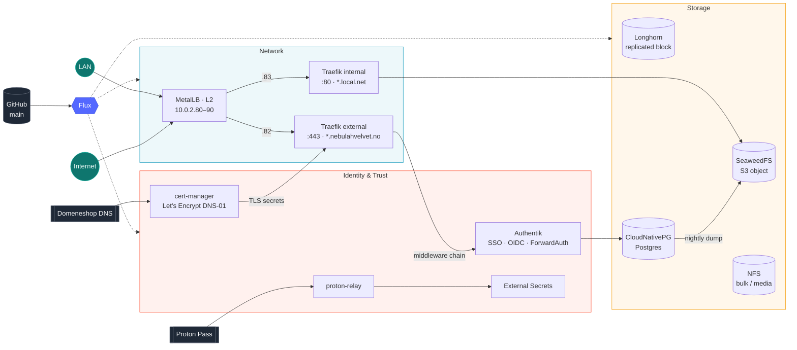

# homelab-nebulahvelvet

[](https://kubernetes.io)
[](https://fluxcd.io)
[](https://traefik.io)
[](https://goauthentik.io)

> Bare-metal Kubernetes, reconciled from Git.

Everything under `cluster/` is the desired state. Flux watches `main` and applies it, so the repo is the only way in.

## Core Platform



| Layer | Component | Role |
|:--|:--|:--|
| GitOps | Flux v2 | Reconciles `cluster/` from `main`, alerts to Discord |
| Network | MetalLB | L2 LoadBalancer IPs from `10.0.2.80–90` |
| Network | Traefik ×2 | External (TLS, bot wrangler, fail2ban, rate limits) and internal LAN, routed by `IngressRoute` only |
| Trust | cert-manager | Let's Encrypt via DNS-01 on Domeneshop |
| Trust | External Secrets + proton-relay | Every secret pulled from Proton Pass |
| Auth | Authentik | SSO with OIDC, SAML and Traefik ForwardAuth |
| Storage | Longhorn | Replicated block storage; `longhorn-retain` for state that must survive |
| Storage | SeaweedFS | S3 object storage for backups |
| Storage | NFS | `nfs-odin` class for media and bulk data |
| Storage | CloudNativePG | Postgres operator, backing Authentik |

## Routing

Two Traefik instances split the edge. **traefik-external** takes `:443` for public hosts. It terminates TLS with cert-manager certificates, and every route passes a middleware chain (bot wrangler, fail2ban, rate and in-flight limits). **traefik-internal** serves `*.local.net` over plain HTTP on the LAN.

Routes are Traefik `IngressRoute` CRDs; the Kubernetes Ingress provider is disabled. Each route carries `kubernetes.io/ingress.class: traefik-external` or `traefik-internal` to pick its instance. Public routes ship their own `Certificate`. Start from [cluster/template/ingressRoute.yaml](cluster/template/ingressRoute.yaml).

## Secrets

Nothing sensitive lives in Git. Secrets come from a Proton Pass vault through [proton-relay](https://github.com/stianmjo/proton-relay) and into the cluster via External Secrets.

```
Proton Pass → proton-relay → ClusterSecretStore → ExternalSecret → Secret
```

Force a resync:

```sh
kubectl annotate externalsecret <name> -n <namespace> force-sync=$(date +%s) --overwrite
```

## Layout

```
cluster/
├── flux/              Flux instance and Discord alerts
├── metalllb/          IP pool and L2 advertisement
├── traefik/           External and internal ingress controllers
├── cert-manager/      ClusterIssuer and Domeneshop DNS-01 webhook
├── external-secrets/  ESO and the proton-relay bridge
├── authentik/         SSO with CNPG Postgres and S3 backups
├── longhorn/          Block storage
├── seaweedfs/         S3 object storage
├── nfs-provisioner/   NFS storage class
├── cnpg/              CloudNativePG operator
└── …                  Workloads on top of the platform
```
