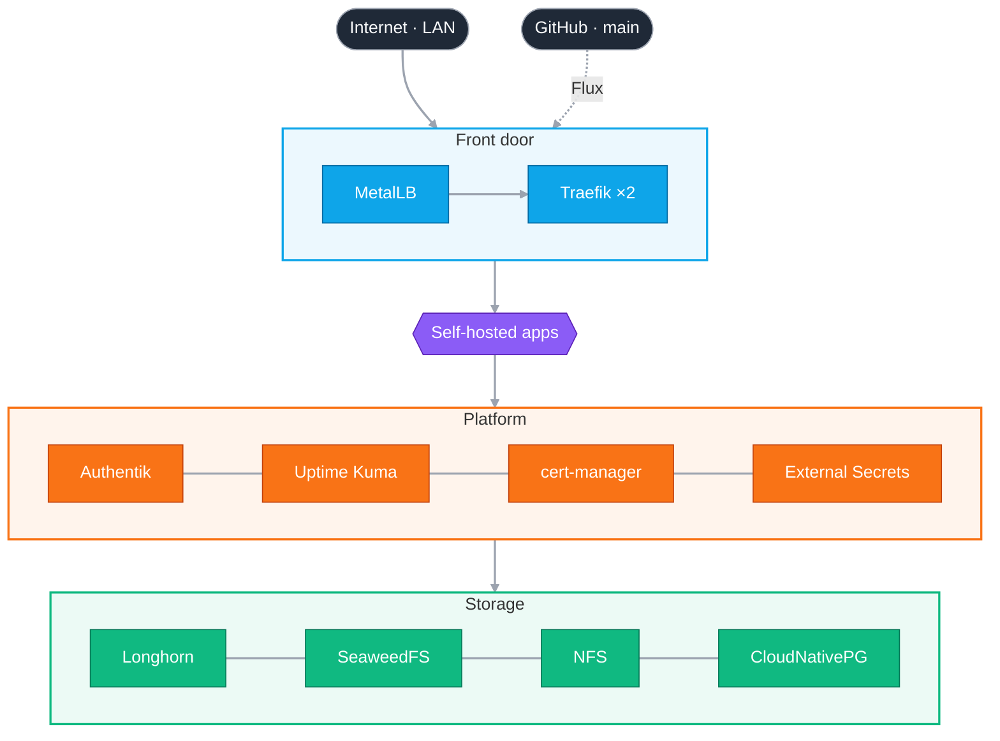

<div align="center">

# homelab-nebulahvelvet

A bare-metal Kubernetes cluster at home, run entirely from this repo.

[](https://kubernetes.io)
[](https://fluxcd.io)
[](https://traefik.io)
[](https://goauthentik.io)
[](https://docs.renovatebot.com)

</div>

---

Four small machines, one Git repo. Everything the cluster runs lives under `cluster/`, and Flux keeps the cluster in sync with `main`. To change something, edit the YAML and push.

## Hardware

| Node | Role | CPU | RAM | OS |
|:--|:--|:--|:--|:--|
| `mpc01` | control plane | 12 cores | 32 GB | Ubuntu 24.04 |
| `mpc02` | worker | 12 cores | 32 GB | Ubuntu 24.04 |
| `mpc03` | worker | 12 cores | 32 GB | Ubuntu 24.04 |
| `mpc04` | worker | 16 cores | 32 GB | Ubuntu 24.04 |

## Overview

Requests come in at the top and work their way down. Each layer relies on the one below it.



| Layer | Component | What it does |
|:--|:--|:--|
| Sync | Flux | Watches `main` and applies it. Pings Discord when something changes |
| Front door | MetalLB | Gives Traefik real LAN IPs (`10.0.2.82` public, `10.0.2.83` internal) |
| Front door | Traefik ×2 | One for the internet, one for the LAN |
| Platform | Authentik | Single sign-on for everything |
| Platform | Uptime Kuma | Status page and monitors for every service |
| Platform | cert-manager | Free Let's Encrypt certificates, renewed automatically |
| Platform | External Secrets + proton-relay | Pulls every secret out of Proton Pass |
| Platform | kube-network-policies | Enforces NetworkPolicies so namespaces can't talk freely |
| Storage | Longhorn | Replicated disks for anything that needs to keep data |
| Storage | SeaweedFS | Internal S3 storage, used for backups |
| Storage | NFS | Big shared storage for bulk data |
| Storage | CloudNativePG | Postgres databases (Authentik's lives here) |

## Networking

There are two Traefik instances, each with its own IP:

- **traefik-external** handles public `*.nebulahvelvet.no` sites over HTTPS. Every route passes bot blocking, fail2ban and rate limits before it reaches an app.
- **traefik-internal** handles `*.local.net` sites on the home network over plain HTTP.

All routes are Traefik `IngressRoute`s; regular Kubernetes Ingress is switched off. Each route picks its Traefik with `spec.ingressClassName`, and public routes bring their own `certificate.yaml`. To add one, copy [cluster/template/ingressRoute.yaml](cluster/template/ingressRoute.yaml).

### Network policies

Every app namespace starts closed. Nothing can reach its pods except:

- pods in the same namespace
- the Traefik instance that serves it, on the app's own port only

The secrets path is locked down the hardest. Only External Secrets can talk to proton-relay, and the relay can only make DNS lookups and HTTPS calls out to Proton. Uptime Kuma gets a separate health-only port so it can watch the relay without reaching any secrets.

Policies live next to each app as `networkpolicy.yaml`. If something breaks, reverting that one file's commit fixes it.

## Secrets

Nothing secret is stored in Git. Secrets live in a Proton Pass vault, and [proton-relay](https://github.com/stianmjo/proton-relay) hands them to External Secrets, which turns them into Kubernetes Secrets.

```
Proton Pass → proton-relay → External Secrets → Kubernetes Secret
```

To pull a secret again right now:

```sh
kubectl annotate externalsecret <name> -n <namespace> force-sync=$(date +%s) --overwrite
```

## Updates

Renovate runs nightly inside the cluster and opens a PR for every new version. It finds most versions by itself:

- chart versions in `HelmRelease`s
- `image:` lines, and `image.repository` / `image.tag` inside `HelmRelease` values

So the rule is simple: **pin an exact version and don't annotate it.** Only when Renovate can't see a version does it get a comment on the line above:

```yaml
# renovate: datasource=github-tags depName=tomMoulard/fail2ban
version: v0.9.0
```

Postgres majors are the one exception: Renovate skips them, and they're done by hand.

## Directories

```
cluster/
├── flux/              Flux itself and Discord alerts
├── network-policies/  kube-network-policies agent
├── metalllb/          IP pool for LoadBalancers
├── traefik/           Internet and LAN routers
├── cert-manager/      Let's Encrypt via Domeneshop DNS
├── external-secrets/  External Secrets and proton-relay
├── authentik/         Single sign-on and its database
├── longhorn/          Replicated disks
├── seaweedfs/         S3 storage
├── nfs-provisioner/   NFS storage
├── cnpg/              Postgres operator
├── renovate/          Nightly dependency updates
├── template/          Starting point for a new app
└── …                  The apps
```
